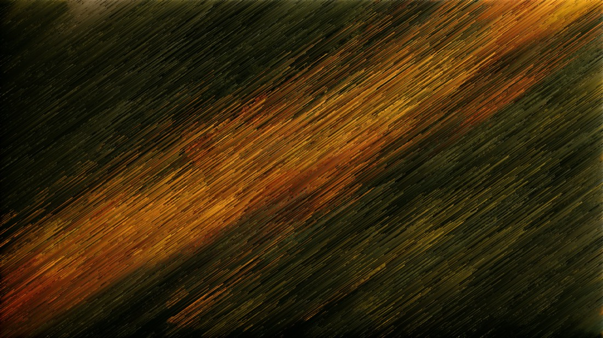

# pixelsort-go

A pixel sorter you can **watch** — live, in the browser, along any angle.

The engine is Go, compiled to WebAssembly, so the sorting runs on whatever device loads the page. A SvelteKit
front end drives it and a small Go server keeps the gallery. It is a ground-up rewrite of the Python/Gradio
[Pixelsorting](https://github.com/AutumnsGrove/Pixelsorting), which stays as an archive of the original.

| Before | After |
|---|---|
|  |  |

*Sorted along 35° with `{"angle":35,"mode":"random","length":180,"randomness":10,"key":"luma","algo":"oddeven"}` —
no rotated edges, no transparent corners.*

**[Every screen, and more of what the engine does, is in the gallery →](docs/gallery.md)**

## What it does

- **Any angle, no rotation.** Pixels are partitioned into staircase lines with `k = y − round(x·tanθ)` — a pure
  permutation, so no lossy rotate-and-crop and no transparent corners.
- **Watch the sort itself.** Stable, visible algorithms advance a step at a time on the same buffer; the last
  frame is guaranteed to equal the instant result.
- **Regions, not reassembly.** Masks and geometric segmentation are one idea: a map of cells and classes, each
  free to freeze, turn, re-key or re-cut. One pass, one buffer, no seams.
- **Everything runs on your device.** The server serves files and stores results; it never touches pixels.

## Try it

Requires Go 1.27, Node, `pnpm` and `golangci-lint` v2.

```bash
make embed-build
./build/pixelsort-go serve     # http://127.0.0.1:8895
```

| Command | What it does |
|---|---|
| `make check` | format check, vet, lint and the fast tests — run before every commit |
| `make test` | every Go test, with the race detector |
| `make fuzz` | a short run of every fuzz target |
| `make wasm` `make wasm-test` | the engine as WebAssembly, and its tests under Node |
| `make web` `make e2e` | the SvelteKit app, and its browser tests |
| `make image` `make compose-test` | the container image, and a check of it |
| `make bench` `make hello` `make spike` | benchmarks, and small ways to poke the engine |

## Where to look next

| | |
|---|---|
| [`docs/gallery.md`](docs/gallery.md) | Every screen, and what the engine does to a photograph. |
| [`PLAN.md`](PLAN.md) | The whole plan: goals, architecture, engine design, gallery, deployment, tests, decisions. |
| [`docs/dev/README.md`](docs/dev/README.md) | **How it gets built** — one test-first plan per phase, plus conventions and testing. |
| [`docs/deploy.md`](docs/deploy.md) | Deploying it. |
| [`docs/handoffs/`](docs/handoffs/) | Where things stand and what happens next. The latest handoff is the best way back in. |
| [`mockups/`](mockups/) | Build-free HTML mockups of every screen — open `mockups/index.html`. |

Open work is tracked in [`docs/dev/PROGRESS.md`](docs/dev/PROGRESS.md).

## Security

Sorting happens in your browser; the server never touches pixels. The service makes outside calls, but only to its
own Cloudflare Worker, carrying only what you explicitly share or fetch. It never contacts the image registry (a
small watcher on the host does, and the app cannot name an image). There are no accounts: access is your tailnet.
"Unlisted" share links are not private. The container runs read-only, as a non-root user, with every capability
dropped.

## Credits

The technique descends from [satyarth/pixelsort](https://github.com/satyarth/pixelsort) (MIT) and, before it,
Kim Asendorf's *ASDF Pixel Sort* Processing script. Icons use [Lucide](https://lucide.dev). Mockup type is
[Instrument Serif](https://fonts.google.com/specimen/Instrument+Serif) and
[DM Mono](https://fonts.google.com/specimen/DM+Mono). Studio's first-run sample is an aerial forest photograph
from [Unsplash](https://unsplash.com) (<https://images.unsplash.com/photo-1793556119647-46da040a5a4c>), used
under the Unsplash License.

## License

[MIT](LICENSE) © 2026 Autumn Brown
