# Gallery

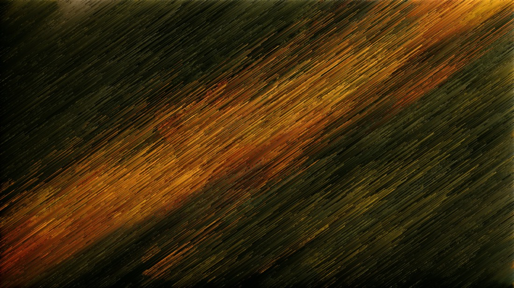

Every picture here is the real thing. The screen shots come out of the browser tests in `web/e2e/`, so they are
whatever the app actually renders; the before/after pair is sorted by the Go engine itself, from the recipe printed
below it.

Rebuild them with:

```bash
make e2e                    # writes the screen shots to web/test-results/
scripts/gallery-images.sh   # sorts the sample and converts everything into docs/images/
```

## The sort

The same photograph twice: untouched, then sorted along 35°. Note there are no rotated edges and no transparent
corners — the pixels are partitioned into staircase lines, not rotated.

| Before | After |
|---|---|
| 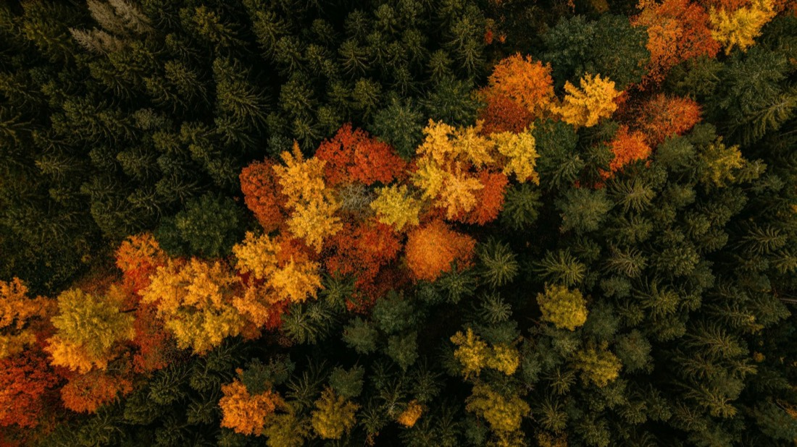 |  |

`{"angle":35,"mode":"random","length":180,"randomness":10,"key":"luma","algo":"oddeven"}`

## Studio

| | |
|---|---|
| 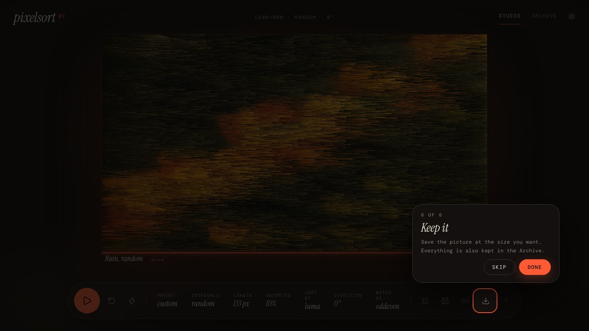 | 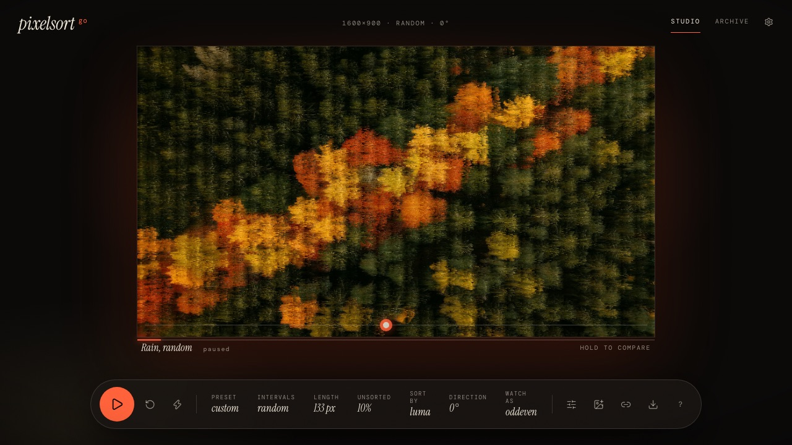 |
| The Studio with a sort finished and the last tour card up. | Paused mid-sort. Hold the handle under the picture to see the original. |

## Shapes

The picture can be cut into cells, and each kind of cell can behave differently.

| | |
|---|---|
| 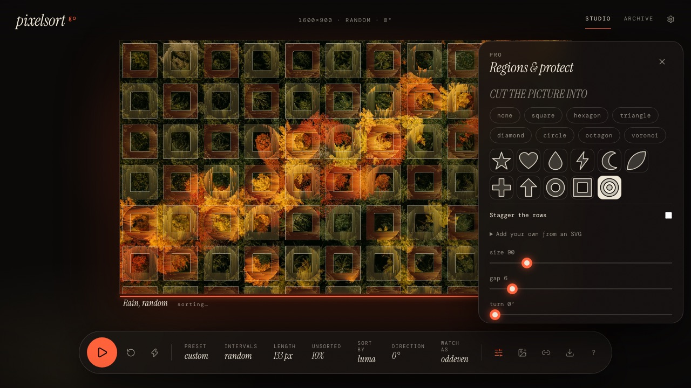 | 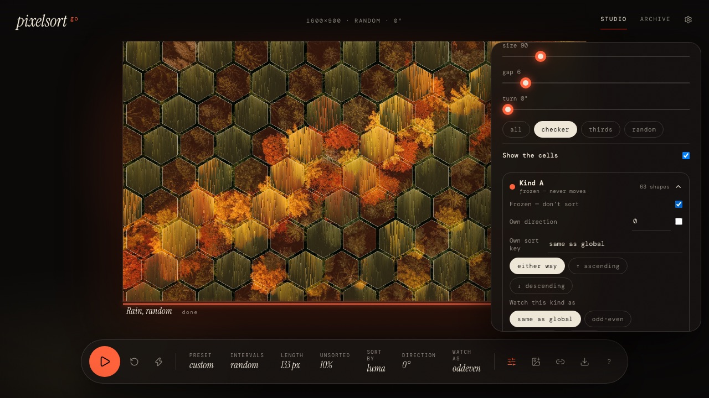 |
| Squares here, with the Shape library beside them: hexagon, triangle, diamond, circle, octagon, voronoi, and a set of glyphs. | Hexagons, with the cells shown. Each kind is frozen, reversed or re-keyed on its own. |

## Rules, per region

| | |
|---|---|
| 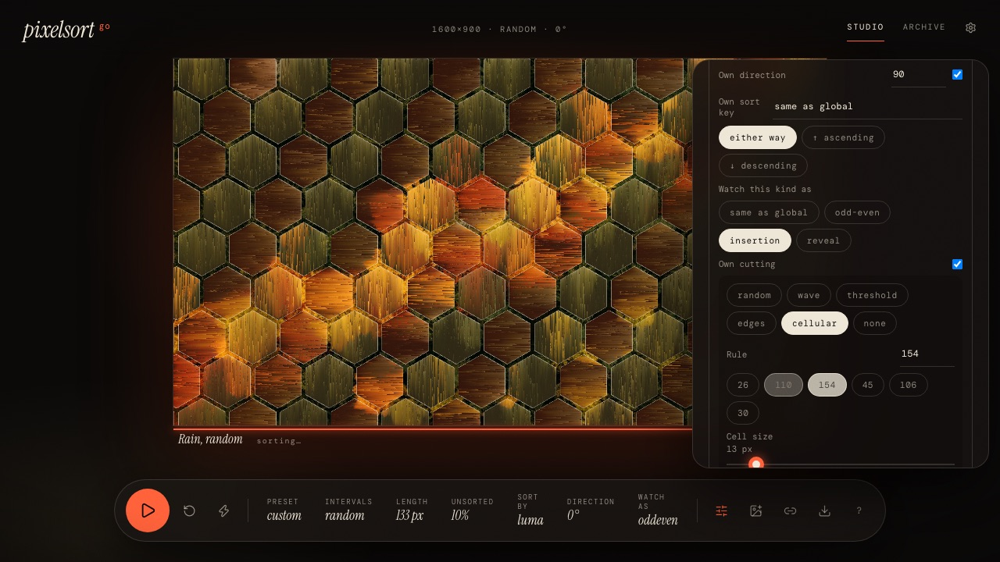 | 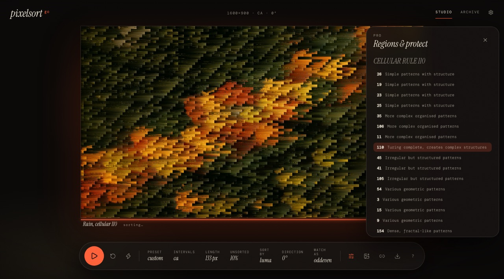 |
| A region kind with its own direction, sort key, algorithm — insertion here — and its own way of cutting. | Cellular rules instead of random intervals. Rule 110, chosen from the list and labelled with what it does. |

## Protect

Anything you protect comes through untouched.

| | |
|---|---|
| 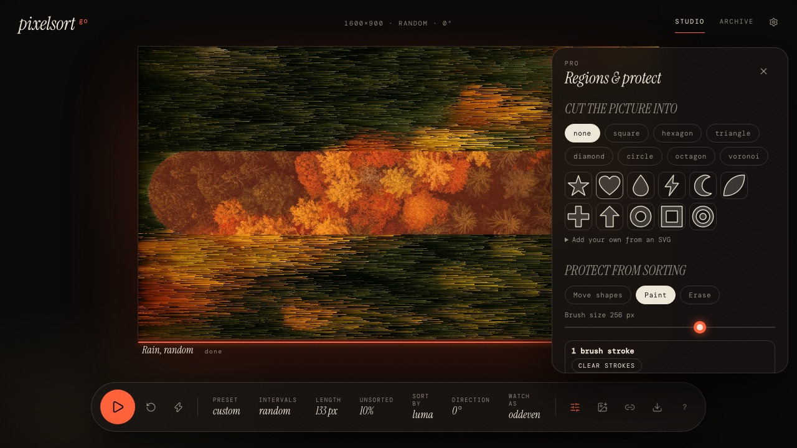 | 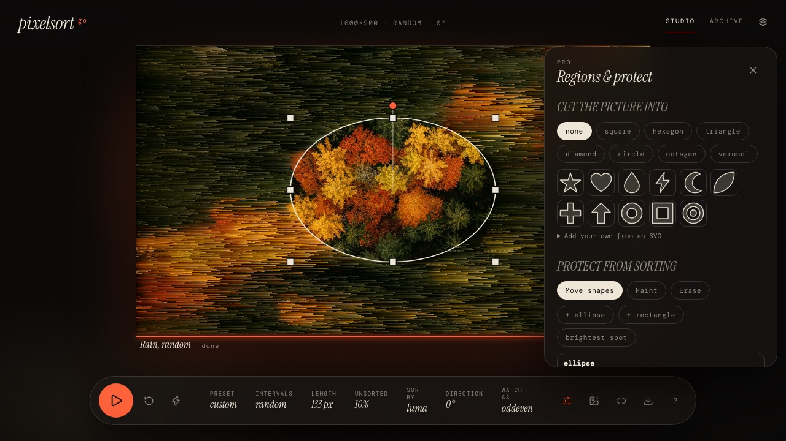 |
| One brush stroke: the band is frozen, everything around it sorts. | Or drag a shape over what matters and resize it by its handles. |

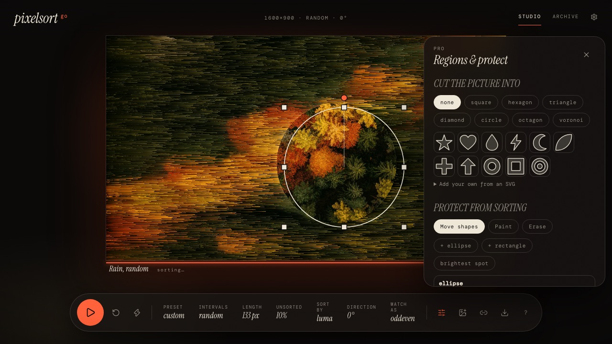

A mask mid-sort: eight handles to resize, the dot above to rotate.

## On a phone

The same app at 390 pixels wide — every control reachable, nothing hidden behind a hover.

| | |
|---|---|
| 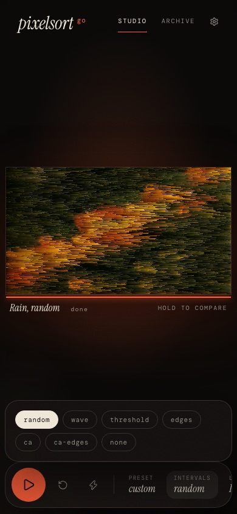 | 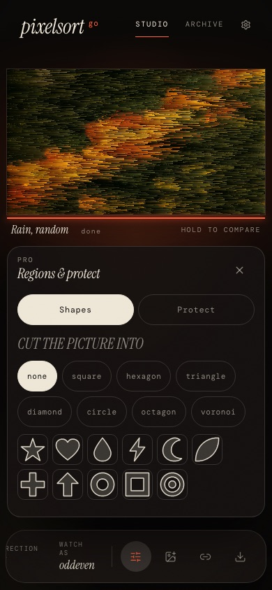 |
| The Studio, with the interval modes as a chip row. | Regions & protect as a sheet rather than a panel. |

| | |
|---|---|
| 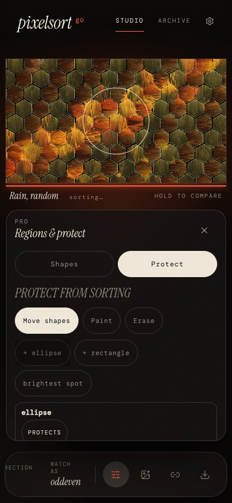 | 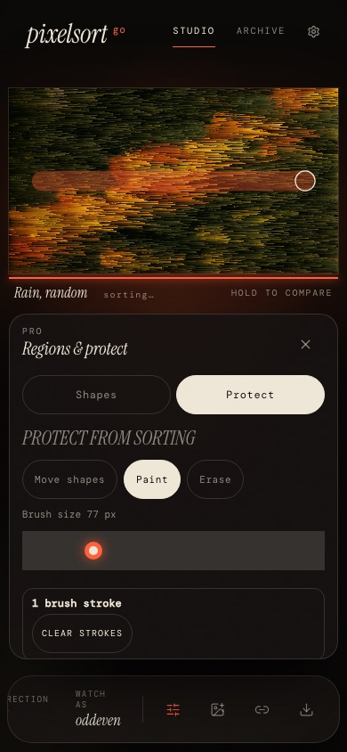 |
| The same sheet, on its Protect tab. | Painting a mask with a finger. |

## Archive and sharing

| | |
|---|---|
| 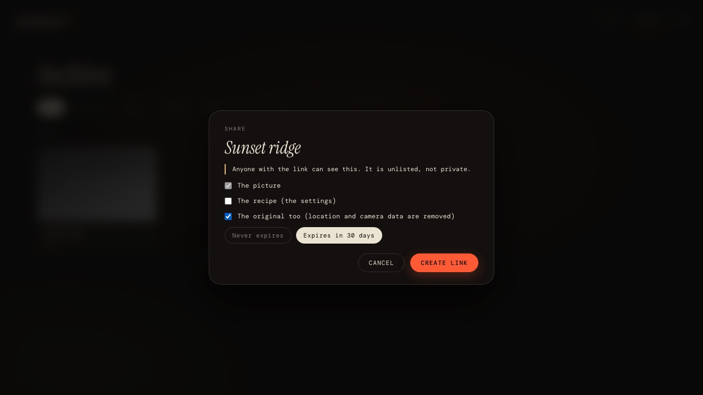 | 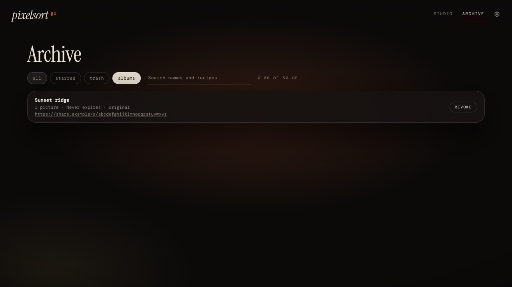 |
| A share link carries only what you tick: the picture, the recipe, the original (with its metadata stripped). | The Archive lists the runs and the share albums, with what each link carries. |
